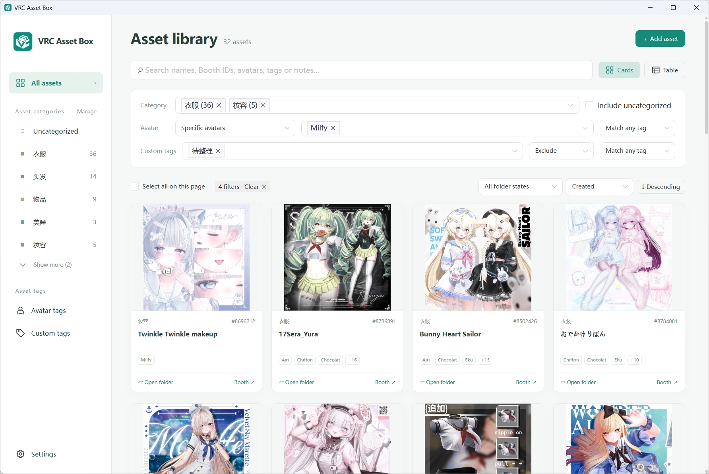
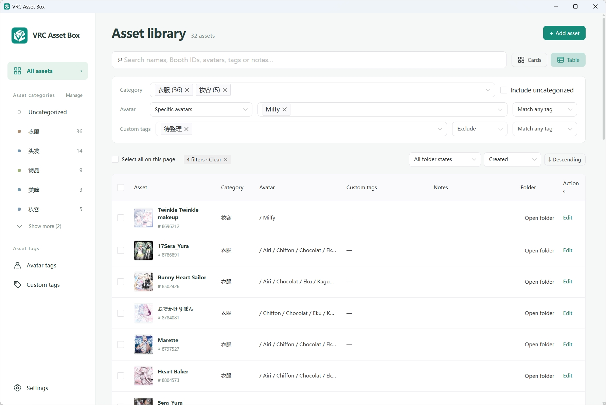
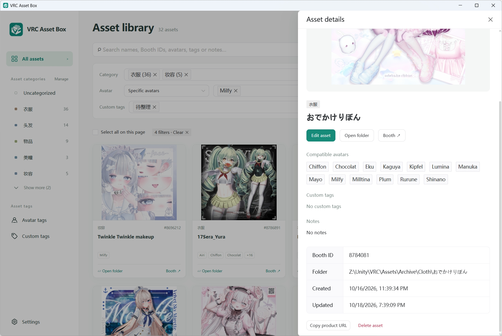
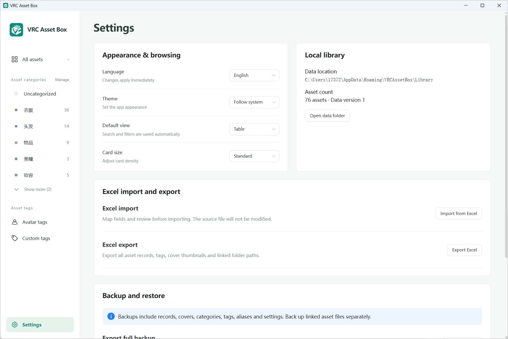

# VRC Asset Box

[English](README.md) | [简体中文](README_ZH.md)

VRC Asset Box is a desktop application primarily for Windows, designed to organize assets collected for VRChat avatar customization. Each asset can include a name, category, optional BOOTH ID, cover image, supported avatars, custom tags, notes, and a linked folder.

## Preview

<table>
  <tr>
    <td>
      
      <p align="center">Asset library in card view</p>
    </td>
    <td>
      
      <p align="center">Asset library in table view</p>
    </td>
  </tr>
  <tr>
    <td>
      
      <p align="center">Asset details</p>
    </td>
    <td>
      
      <p align="center">Settings</p>
    </td>
  </tr>
</table>

## Languages

Choose one of the following languages in Settings. “Follow system” is selected by default:

- English
- Simplified Chinese
- Traditional Chinese
- Japanese
- Korean

## Download

Download a prebuilt version from [GitHub Releases](https://github.com/xiaolazhu/vrc_asset_box/releases).

The application requires the WebView2 Runtime.

## Build from source

### Requirements

- Go 1.25 or later
- Node.js 22.12 or later
- npm
- Wails CLI v2

Install the Wails CLI and check the build environment:

```powershell
go install github.com/wailsapp/wails/v2/cmd/wails@latest
wails doctor
```

Run the application in development mode:

```powershell
wails dev
```

Build the Windows executable:

```powershell
wails build -clean
```

Or build with UPX compression:

```powershell
wails build -clean -upx
```

## Contributing

Submit bug reports and feature requests through [GitHub Issues](https://github.com/xiaolazhu/vrc_asset_box/issues). Contributions via pull requests are welcome.

## License

This project is distributed under the [MIT License](LICENSE).
